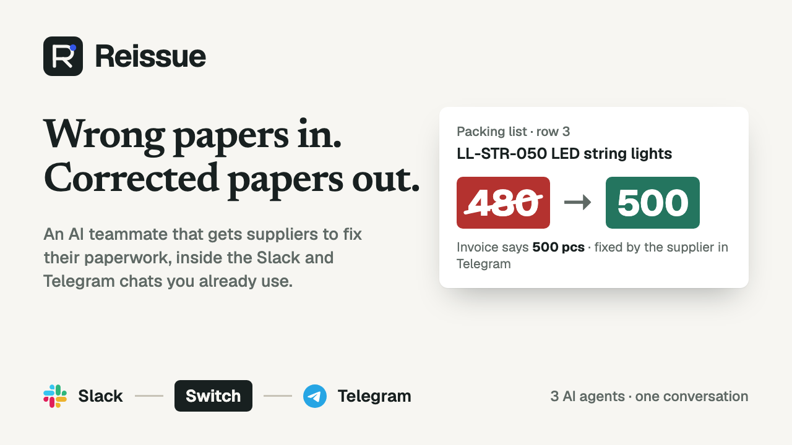
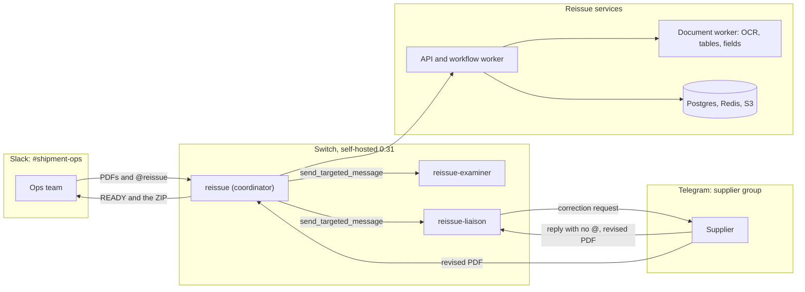
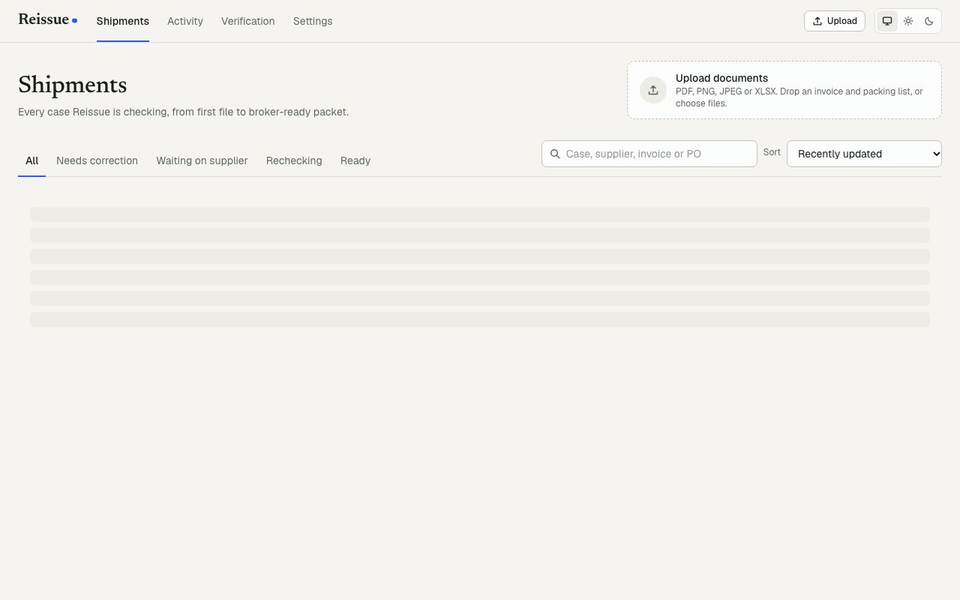

<p align="center">
  <a href="https://github.com/winsznx/reissue/releases/download/v1.0.0/reissue-demo.mp4"></a>
</p>

# Reissue

**Wrong shipping papers in. Corrected shipment package out.**

[](https://github.com/winsznx/reissue/actions/workflows/ci.yml)
[](LICENSE)
[](https://docs.switchagents.ai)
[](switch/setup.md)

**[Watch the 2-minute demo](https://github.com/winsznx/reissue/releases/download/v1.0.0/reissue-demo.mp4)** ·
[How it uses Switch](#switch-features-it-depends-on) · [Run it](#run-it-locally) ·
[Measured results](docs/TEST_RESULTS.md) · [Release notes](CHANGELOG.md)

Reissue is an AI teammate for import and freight teams. When a supplier's commercial invoice and
packing list disagree, the customs broker won't move the goods. Reissue finds the exact row, gets
the supplier to send a corrected file from their own Telegram group, rechecks it, and hands the
team a broker-ready packet in Slack. Nobody leaves their chat.

Built for **Flip the Switch** (WeMakeDevs, DevTools Academy and Switch), Track 01: Best Business
Workflow.

| On real Slack and Telegram | |
|---|---|
| Supplier's revised PDF to Ready for broker review | **0.41 s** (SHP-0290) |
| Revised PDF to the ZIP in the Slack thread | **0.74 s** (SHP-0290) |
| Two PDFs in Slack to the exact row, with page and row | **0.58 s** (SHP-0287) |
| Planted discrepancies found on controlled test documents | **10 of 10**, with 0 false alerts |
| Integration tests on real Postgres, Redis, S3 and the document worker | **36 of 36** |

Drop a commercial invoice and packing list into the operations room and mention `@reissue`.
Reissue then:

1. finds the exact contradiction, down to page and row
2. has a second agent verify the evidence
3. asks the supplier in their own Telegram group
4. follows the supplier's natural replies
5. takes in the revised PDF they send
6. rechecks everything on its own
7. returns a packet of the current, unaltered supplier files for the broker

All of this runs on [Switch](https://docs.switchagents.ai): rooms, agent identities, follow-ups,
agent-to-agent handoffs and file delivery.



## The loop

```text
Slack #shipment-ops                     Switch                     Telegram supplier group
──────────────────                      ──────                     ───────────────────────
Dana: @reissue check these  ──files──▶  reissue (coordinator)
  invoice.pdf  packing-list.pdf          │ extract · reconcile (deterministic)
                                         │ "D-001 Quantity · LL-STR-050
◀── Invoice 500 pcs (p.1 row 3)          │  Invoice 500 / Packing list 480"
    Packing list 480 pcs (p.1 row 3)     │
                                         ├─ send_targeted_message ─▶ reissue-examiner
                                         │                 (Claude Code + evidence tools)
                                         │◀─ DOCUMENT_REVIEW_RESULT: CONFIRMED, cited
                                         ├─ send_targeted_message ─▶ reissue-liaison ──▶ "Please confirm
                                         │                                              LL-STR-050…"
                                         │                    supplier, no @ (follow-up) ◀── "Old list, we
                                         │◀─ SUPPLIER_REPLY_RELAYED ─ liaison ──────────▶  shipped 500"
                                         │◀───────────── packing-list-v2.pdf (Telegram file) ─────
                                         │ v2 supersedes v1 · epoch 2 · recheck · all checks pass
◀── READY FOR BROKER REVIEW + ZIP        │
    01-commercial-invoice-v1.pdf
    02-packing-list-v2.pdf   correction-summary.pdf   document-index.csv
```

Each arrow above is a real Switch message. The loop has run on real Slack and Telegram accounts
through a self-hosted Switch 0.31.0 server. On 2026-11-07, case SHP-0287 went from the supplier's
revised PDF in Telegram to the ZIP in the Slack thread in 0.75 s. The scripted test runs use
Mattermost rooms on the same server (see [switch/setup.md](switch/setup.md)).

## The Workbench



<sub>A real run of the quantity-correction scenario, recorded with `apps/web/scripts/record-gif.mjs`.</sub>

The web app opens on a public overview page at `/`. Behind sign-in, the Workbench shows each case
with both documents side by side, evidence highlights on the cited rows, versions, a live
timeline, decisions and downloads.

## What's in the box

| Part | Path | What it does |
|---|---|---|
| Coordinator agent | `apps/switch-coordinator` | Always-on custom Switch agent over WebSocket (agent-protocol 8). Keeps one resumable connection per room, stores each event under a dedupe key before acting, recovers gaps with `read_context`, and delivers the outbox in order |
| Specialist agents | `apps/agent-runtime`, `agents/*/AGENT.md` | `reissue-examiner` and `reissue-liaison`, each its own Switch agent running headless Claude Code against role-scoped Reissue MCP tools. They can also run as Switch Console managed agents from `switch/template.yaml` |
| API | `apps/api` | REST, SSE live stream, MCP tool endpoint, intake, signed downloads, scenarios, verification, OpenAPI |
| Workflow worker | `apps/worker`, `packages/workflows` | Durable jobs for extraction, reconcile, handoffs, supplier asks, reminders, escalation and packets |
| Document worker | `apps/document-worker` (Python) | Classifies by content, splits combined PDFs, extracts tables and fields with page, bbox and quote, OCR fallback, XLSX |
| Reconciler | `packages/core` | Decimal-exact unit normalisation, SKU-first Hungarian line matching, 12 rule types, root-cause issue grouping, state machines |
| Workbench | `apps/web` | Public overview page at `/`. Behind sign-in: document compare with evidence highlights, issues, versions, live timeline, decisions, downloads, scenarios |
| Packet | `packages/artifacts` | ZIP of unaltered current files, `correction-summary.pdf`, `document-index.csv`, all hash-verified |

## Switch features it depends on

| Switch release | Used for | Where |
|---|---|---|
| Server 0.30.0: Telegram | Supplier group is a Switch room. The liaison posts there, and supplier files arrive as attachment refs | `packages/workflows/src/inbound.ts`, `switch/setup.md` |
| Server 0.31.0: follow-ups | Supplier replies in the request thread with no @ and reaches the liaison. The liaison is the supplier room's main agent | `apps/switch-coordinator/src/setup-local.ts`, `apps/agent-runtime/src/main.ts` |
| Server 0.31.0: agent-to-agent messages | Coordinator → examiner (`DOCUMENT_REVIEW_REQUESTED`), coordinator → liaison (`SUPPLIER_REQUEST_ASSIGNED`), and both reply back, all via `send_targeted_message`. `delegate_task` isn't used and `verify:switch` checks it's absent | `packages/workflows/src/collaboration.ts`, `packages/contracts/src/agents.ts` |
| Console 0.40.0: managed agents | `switch/template.yaml` declares the examiner and liaison as managed Claude Code agents. It was validated with `save_template` on 0.31.0 | `switch/template.yaml` |
| Agent protocol (WebSocket, ops, media) | `connection_state`, ping/pong, resume with `start_from` + `expected_generation`, `gap`, `evicted`; ops discovered at `GET /agents/{id}/ops`; media download and upload routes | `packages/switch-adapter` |

Turn Switch off and the Workbench can still parse an uploaded PDF. Without it, though, nobody can
open a case from chat, the supplier can't answer in the shared conversation, and no handoff
completes.

## Run it locally

Requirements: Node 22+, pnpm, Docker, [uv](https://docs.astral.sh/uv/), and Tesseract
(`brew install tesseract`) for scanned documents.

```bash
pnpm bootstrap                 # deps, .env with secrets, Postgres/Redis/S3, migrations, builds
scripts/stack.sh start         # document worker, API :4210, workflow worker, Workbench :3210
```

Open http://localhost:3210 for the overview page. **Open the Workbench** signs you in with the
access code printed by bootstrap (`WORKBENCH_ACCESS_CODE` in `.env`). Then go to
**Verification → Start** to run any curated scenario through the real pipeline. Scenarios post
into whichever operations room is bound, so with Slack connected they appear in your Slack
channel.

### With Switch (local, no external accounts)

```bash
scripts/switch-local.sh up                                 # Switch 0.31.0 + Mattermost in Docker
pnpm --filter @reissue/switch-coordinator setup:local      # agents, rooms, supplier account, follow-ups
scripts/stack.sh restart                                   # adds coordinator, examiner, liaison
pnpm verify:switch                                         # health, ops, rooms, live connections
pnpm test:live                                             # full loop with two Mattermost accounts
```

Mattermost runs at http://localhost:8065. Sign in as `user` to post in `shipment-ops`, or as
`li.wei` to answer in `supplier-corrections`. The passwords are in `.data/switch/`. The examiner
and liaison call `claude`, so Claude Code needs to be installed and signed in.

### With Slack and Telegram

Follow [switch/setup.md](switch/setup.md), path B, either in Switch Console or straight through
the gateway API on the local server. The Telegram group has to be created by hand, because bots
can't create groups. Then `pnpm --filter @reissue/switch-coordinator connect-rooms` binds the
rooms.

## Tests

```bash
pnpm turbo run test --filter='!@reissue/tests'   # unit tests: reconciler, adapter, artifacts, classifier, document worker
pnpm test:integration     # 36 tests on real Postgres, Redis, S3 and the document worker
pnpm scenario             # curated scenarios through the API, expected vs observed
pnpm test:live            # live Switch loop (needs the local Switch setup)
pnpm --filter @reissue/web test:e2e   # Workbench in a real browser
pnpm verify:packet <zip> --source <original.pdf>...   # check a downloaded packet yourself
```

CI runs types, lint, the build and the unit tests on every push. Results, timings and counts are in
[docs/TEST_RESULTS.md](docs/TEST_RESULTS.md) and [docs/SPONSOR_BEHAVIOUR.md](docs/SPONSOR_BEHAVIOUR.md).

## Design rules

- **Models read, code decides.** The document worker and the agents propose and phrase.
  Deterministic code decides versions, conversions, arithmetic, issue state, readiness and what
  goes in the packet. Only a clean recheck makes a case ready.
- **The supplier sees only what they need.** That's the case code, the field, both stated values
  and the page. The liaison's tool token can't reach documents, prices or other cases.
- **Original bytes are never changed.** Files are stored content-addressed by SHA-256. The packet
  refuses any file whose bytes don't match, and `verify-packet` lets anyone re-check that.
- **Every outbound message is sent exactly once.** It's written to an outbox under a dedupe key
  before it's delivered. If Switch is down, messages wait and go out once.
- **Untrusted input stays data.** Instructions inside a PDF or a chat message can't change an
  agent's role or the case state.

More in [docs/KNOWN_BEHAVIOUR.md](docs/KNOWN_BEHAVIOUR.md). Sources and prior art are in
[docs/SOURCES.md](docs/SOURCES.md).

## Repository map

```text
apps/        api · worker · switch-coordinator · agent-runtime · document-worker · web
packages/    contracts · core · db · workflows · switch-adapter · artifacts · ai
agents/      examiner · liaison · coordinator instructions
switch/      template.yaml · room-instructions/ · setup.md
tests/       integration/ · end-to-end/ · fixtures/ · scenario-runs/
scripts/     bootstrap · stack · switch-local · verify-switch · verify-packet · run-scenario
docs/        SOURCES · SPONSOR_BEHAVIOUR · TEST_RESULTS · DEMO_SCRIPT · KNOWN_BEHAVIOUR
```

## Contributing back to Switch

While filming, Switch's Telegram adapter dropped a supplier's PDF after a single `getFile` timeout,
and the bridge relayed "attachment not relayed" instead of the file. We traced it to the adapter's
one-shot download and sent the fix upstream:
[sandbox-quantum/switch#1689](https://github.com/sandbox-quantum/switch/pull/1689) retries a
network failure up to three times and still fails a definite refusal at once. It comes with three
adapter tests, and 3,269 bridge tests pass.

## Contributing and license

Issues and pull requests are welcome. See [CONTRIBUTING.md](CONTRIBUTING.md), the
[Code of Conduct](CODE_OF_CONDUCT.md) and the [security policy](SECURITY.md). Reissue is released
under the [MIT License](LICENSE).
